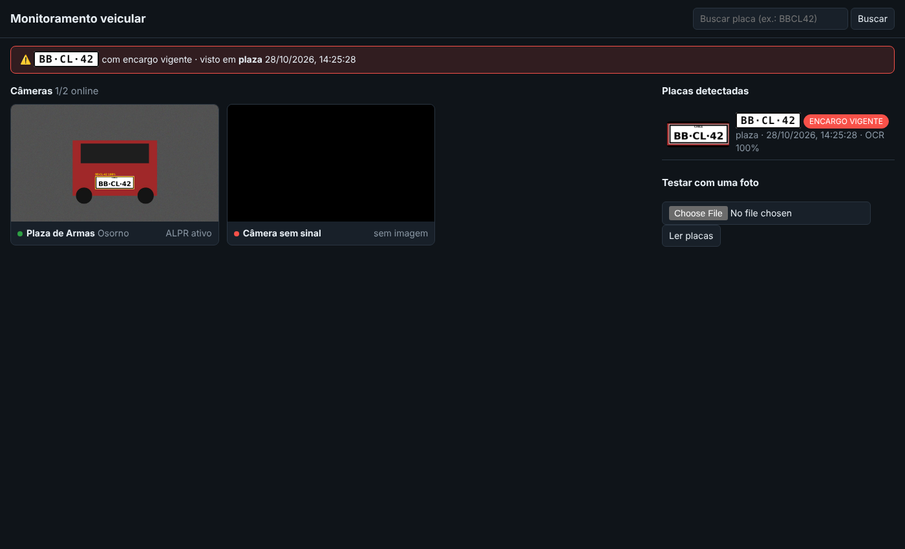

# Monitoramento veicular

Plataforma em Python que reúne as câmeras públicas do [PortalImo](http://www.portalimo.cl/)
(I. Municipalidad de Osorno), lê as placas dos veículos com visão computacional e consulta
cada placa no [Autoseguro](https://www.autoseguro.gob.cl/) para saber se há encargo por roubo.



## Como funciona

```
câmeras (snapshot / MJPEG / HLS / RTSP)
   │  uma thread por câmera
   ▼
YOLOv9 detecta a placa ──► OCR lê o recorte ──► normalização do formato chileno
   │                                              (corrige O/0, B/8, I/1...)
   ▼
SQLite (detecções + imagens)  ──►  fila do Autoseguro (navegador assistido)
   │
   ▼
FastAPI: painel web, API REST, alertas de encargo vigente
```

* **Detecção + OCR**: [`fast-alpr`](https://github.com/ankandrew/fast-alpr) (YOLOv9 + CCT OCR em
  ONNX). Roda em CPU, sem PyTorch; ~13 MB de modelos baixados na primeira execução.
* **Placas chilenas** (`camaras/plates.py`): formatos `LLLL·NN` (desde 2007, só consoantes sem
  M/N/Ñ/Q), `LL·NNNN` (antigo), `LLL·NN` e `LL·NNN` (motos). Leituras fora desses formatos são
  descartadas; o OCR é corrigido posição a posição.
* **Duplicatas**: a mesma placa na mesma câmera dentro de 2 min conta uma vez.
* **Autoseguro** (`camaras/autoseguro.py`): o site é feito para consulta humana, então a
  integração é *assistida*. Um Chromium visível abre o site e preenche "Por placa patente".
  O site exige reCAPTCHA, então a consulta fica em "resolva o captcha" até o operador
  resolvê-lo na janela; só então a plataforma envia a busca. **A plataforma não burla captcha.**
  Há intervalo mínimo entre consultas (15 s) e cache de 24 h por placa. O site devolve o
  resultado como JSON na própria página; a plataforma lê esse JSON e o classifica com a mesma
  regra do JavaScript do site (encargo vigente, encargo parcial ou sem encargo), resultando em
  `encargo` / `sem_encargo` / `erro` (inclusive o limite diário de consultas do site). Um print
  da tela fica salvo como evidência. Placas com encargo aparecem
  num alerta no topo do painel, com a câmera e o horário em que foram vistas.

## Instalação

```bash
python -m venv .venv && source .venv/bin/activate
pip install -r requirements.txt
playwright install chromium          # navegador usado na consulta ao Autoseguro
cp config.example.yaml config.yaml
```

## Uso

```bash
# 1. (Opcional) O config.example.yaml já traz as 18 câmeras do portal. Para atualizar a lista:
python -m camaras descobrir http://www.portalimo.cl/

# 2. Subir o painel (http://localhost:8000)
python -m camaras servir

# Testar o reconhecimento numa foto
python -m camaras analisar foto.jpg --saida anotada.jpg
```

Tipos de câmera no `config.yaml`:

| tipo       | quando usar                                                        |
|------------|--------------------------------------------------------------------|
| `snapshot` | a URL devolve um JPEG novo a cada requisição                       |
| `stream`   | MJPEG, HLS (`.m3u8`) ou RTSP: qualquer coisa que o OpenCV/FFmpeg abra |
| `pagina`   | a URL é uma página HTML; a imagem/stream é descoberta nela          |

## API

| método | rota | descrição |
|---|---|---|
| GET | `/api/cameras` | câmeras, status e placas no quadro atual |
| GET | `/api/cameras/{id}/mjpeg` | vídeo anotado (MJPEG) |
| GET | `/api/cameras/{id}/quadro.jpg` | último quadro |
| GET | `/api/deteccoes?placa=&camera=&desde_id=` | histórico de detecções |
| GET | `/api/placas/{placa}` | histórico da placa + resultado do Autoseguro |
| POST | `/api/placas/{placa}/consultar` | coloca a placa na fila do Autoseguro |
| GET | `/api/alertas` | placas com encargo vigente |
| POST | `/api/analisar` | roda o ALPR numa imagem enviada |

Documentação interativa em `/docs`.

## Testes

```bash
pytest                 # inclui o teste com os modelos reais (marcador "modelo")
pytest -m "not modelo" # só os testes rápidos, sem baixar modelos
```

## Pendências

* Seletores do Autoseguro e lista de câmeras conferidos nos sites reais em 10/2026. Ainda não
  foi feita uma consulta completa (o reCAPTCHA precisa de uma pessoa) nem a leitura de placas
  em quadros reais das câmeras (os servidores das câmeras, `216.155.78.8` e `190.121.3.148`,
  não estavam acessíveis no ambiente de desenvolvimento).
* As câmeras de um portal municipal costumam ter resolução e ângulo pensados para paisagem, não
  para leitura de placa. Vale testar com imagens reais e, se as placas ficarem muito pequenas,
  usar `detector_model: yolo-v9-t-640-license-plate-end2end`.

## Uso responsável

O Autoseguro informa que seus dados não devem ser usados para fins distintos dos informados no
site. Use a plataforma para a finalidade de segurança pública a que se destina, respeite a
legislação chilena de proteção de dados (Lei 19.628 e Lei 21.719) e mantenha o ritmo de consultas baixo.
